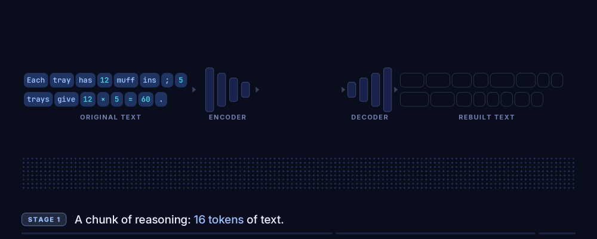

<h1 align="center">
Token Assorted: Mixing Latent and Text Tokens for Improved Language Model Reasoning
<br>
[ICML 2025]
</h1>

[](https://www.python.org/)
[](https://pytorch.org/)
[](https://arxiv.org/abs/2502.03275)

<p align="center">
  
</p>

Unofficial implementation of *Token Assorted: Mixing Latent and Text Tokens for Improved Language Model
Reasoning* (100+ citations as of Oct 2026), covering
**both stages** of the math-reasoning pipeline.

Paper link: https://arxiv.org/abs/2502.03275

**Paper summary.** Chain-of-thought traces are long, and much of their text serves fluency rather than
reasoning. The paper replaces the *initial* part of each trace with discrete latent tokens produced by a
VQ-VAE, keeps the rest as ordinary text, and fine-tunes an LLM on this hybrid sequence with an extended
vocabulary. To help the model adapt to the unseen latent tokens, training randomly varies how much of the
trace is latent, mixing latent and text tokens. The result is shorter reasoning traces (an average
**17% reduction** in trace length), and the authors report that the approach consistently outperforms
their baselines on logical and mathematical reasoning benchmarks, e.g. **+4.1%** on GSM8K with
Llama-3.2-3B.

- **Stage 1** trains a **VQ-VAE that compresses chain-of-thought (CoT) reasoning text into a short
  sequence of discrete latent token indices, and decodes those indices back to text** (`src/train.py`,
  `src/encode_dataset.py`, `src/decode_codes.py`).
- **Stage 2** **fine-tunes an LLM** (unsloth Llama-3.2 series) on **assorted latent + text** reasoning
  traces — the first *m* CoT tokens replaced by their latent codes (`src/stage2_finetune.py`,
  `src/stage2_data.py`, `src/stage2_eval.py`).

---

## What this repo delivers

1. Loads **MetaMathQA** (`meta-math/MetaMathQA`) from HuggingFace.
2. **`src/train.py`** — trains the VQ-VAE.
3. Saves the trained model (token embedding + encoder + codebook + decoder).
4. **`src/encode_dataset.py`** — converts the CoT portion of each example into discrete code indices
   and writes a JSONL artifact. **This file is the Stage-1 → Stage-2 hand-off boundary.**
5. **`src/decode_codes.py`** — decodes code indices back to text, for sanity checks / interpretability.
6. **`src/stage2_data.py`** — extends the Llama tokenizer with 1026 latent tokens
   (`<boLatent>`, `<eoLatent>`, `<Latent-code-0..1023>`) and builds the randomized latent/text training
   mix from the JSONL artifact.
7. **`src/stage2_finetune.py`** — fine-tunes `unsloth/Llama-3.2-1B`(or 3B) on those assorted
   sequences.
8. **`src/stage2_eval.py`** — greedy-decode evaluation on GSM8K, MATH and five
   out-of-domain math benchmarks, each scored by its own official evaluator (`src/official_eval.py`).

### Out of scope
This repo covers only the paper's math-reasoning experiments; the two other domains it evaluates, navigation/planning and logical reasoning, are not implemented:
- The Keys-Finding Maze.
- ProntoQA / ProsQA.

### Differences from the paper
- **Stage-2 learning rate:** 1e-4 instead of the paper's 2.5e-5 (Llama-3.2-1B).
- **Dataset:** the original MetaMathQA instead of the paper's version regenerated with Llama-3.1-405B-Instruct, we could not find that dataset.
- **Codebook training:** EMA updates instead of gradient descent on the VQ loss.
- **Base model:** the ungated `unsloth/Llama-3.2-*` mirrors (1B, 3B and their Instruct variants) instead of Meta's official `meta-llama/Llama-3.2-*` repos, because the official ones are gated and we did not get access.
- **Reasoning length:** Stage 2 trains on reasoning that fits the Stage-1 sequence length of 256 tokens, while we think the paper uses the full reasoning. With the full reasoning (Llama-3.2-1B), Latent still trails CoT: GSM8K −4.2 points (−5.0 with the 256-token limit), MATH −0.4 (−1.8).

### Requirements
Requires Python 3.10+ and **a single** CUDA GPU for full training, with an NVIDIA driver that supports
**CUDA 12.8** (the smoke test runs on CPU). Multi-GPU is not supported. We tested with Python 3.12 and
CUDA 12.8 on an NVIDIA RTX PRO 6000 Blackwell Server Edition, 96 GB. Later versions may work, we have not tested that.

---

## Stage 1 — VQ-VAE: CoT compression into latent codes

Trains a **VQ-VAE** on MetaMathQA that compresses each chain-of-thought into a short sequence of
discrete latent codes (16 text tokens → 1 code, codebook of 1024 entries) and decodes those codes
back to text. The loss, components and architecture walkthrough are in
[src/README.md](src/README.md#stage-1--vq-vae-cot-compression-into-latent-codes).

---

### Setup

```bash
uv venv --python 3.12
uv pip install -r requirements.txt
```

**Tokenizer:** Stage 1 and Stage 2 must share one tokenizer, `unsloth/Llama-3.2-1B`. It is the `tokenizer_name` config field.

---

### Usage

```bash
# 0) (optional) pre-download MetaMathQA (~188 MB; otherwise fetched on the first real run)
python scripts/download_data.py --out ./data

# 1) Smoke test (CPU, offline, ~25 s)
python -m src.train --config config/vqvae_llama.yaml --smoke

# 2) Full training (GPU, 100k steps, ~3 h)
#    batch size: --batch-size N (default 32, uses ~17 GB of GPU memory)
python -m src.train --config config/vqvae_llama.yaml \
    --mlflow-tracking-uri sqlite:///mlflow.db

# 3) Encode every example's CoT into latent codes (the Stage-2 input), run after training run from previous command is completed
python -m src.encode_dataset --checkpoint runs/vqvae-llama/best.pt \
    --split train --compress-target cot --out ./data/metamath_latent_codes.jsonl

# 4) (optional)Sanity check: decode codes back to text
python -m src.decode_codes --checkpoint runs/vqvae-llama/best.pt \
    --codes ./data/metamath_latent_codes.jsonl --num-examples 5

# 5) (optional) Round-trip eval: encode held-out validation CoT, decode it back from its codes, report token_f1 / number_preserved
python -m src.roundtrip_eval --run-dir runs/vqvae-llama
```

Useful flags: `--device {auto,cuda,mps,cpu}`, `--resume <ckpt>`, `--limit N`, `--no-mlflow` (MLflow
logging is on in the shipped configs via `mlflow: true`; runs land in `./mlruns` unless `--mlflow-tracking-uri` is set), `--no-deterministic` (training is bit-reproducible by default, ~2–11% slower).
Any config field can also be edited in `config/vqvae_llama.yaml` or overridden with a CLI flag; the
hyperparameters are listed in [src/README.md](src/README.md#hyperparameters).

---

### Metrics & observed results

> **Note:** The paper's authors did not publish Stage-1 (VQ-VAE) results, so the numbers below are our own measurements with no reference values to compare against.

Printed to the terminal every `log_every` steps (train) and every `eval_every` steps (val):

- `loss` — total training objective, `recon_ce + vq_loss`.
- `recon_ce` — reconstruction cross-entropy (nats/token) of the decoder output vs. the original tokens, over non-pad positions of the full sequence `X`.
- `recon_acc` — fraction of non-pad tokens the decoder reconstructs correctly (argmax equals the target).
- `vq_loss` — quantizer loss; with the EMA codebook it is only `β · commitment` (shown as `0.0` on val by design).
- `codebook_active_frac` — fraction of the `|E|` codebook entries used in the current batch (capped by the number of valid codes per batch).
- `codebook_perplexity` — `exp(entropy)` of the code-usage distribution in the batch: ~1 means collapse onto one code, ~`|E|` means uniform usage.
- `lr` — current learning rate (train only).
- `global_active_frac`, `global_perplexity` — the same two codebook statistics accumulated over the whole validation set, the reliable collapse signal (val only).

Printed by the post-training round-trip eval, which encodes held-out validation CoT and decodes it back from its codes:

- `token_f1` — bag-of-tokens (multiset) F1 between the decoded and the original CoT token ids.
- `number_preserved` — fraction of the distinct numbers in the original CoT that also appear in the decoded CoT.

**Table legend:**

- **Repeat up-sampler**: copies each code across the 16 token positions of its chunk before decoding.
- **Learned up-sampler**: replaces that copy with a learned `ConvTranspose1d`.
- **Learned up-sampler + vanilla blocks**: keeps the learned up-sampler but swaps the searchformer transformer blocks for a plain pre-norm transformer.
- Mean ± sample std over seeds 0, 1, 2 (deterministic runs) at each run's best validation checkpoint.
- 🥇 best mean · ↑ higher is better · ↓ lower is better.
- `recon_*` and `global_*` are measured on the validation split (last 2,000 rows); `token_f1` and `number_preserved` are round-trip metrics on 100 held-out validation examples.

| Metric | 🔁 Repeat up-sampler | ✨ Learned up-sampler | 🧱 Learned up-sampler + vanilla blocks |
|:--|:-:|:-:|:-:|
| 📝 **Reconstruction** | | | |
| `recon_ce` ↓ | 2.992 ± 0.011 | 🥇 **2.163 ± 0.007** | 2.227 ± 0.004 |
| `recon_acc` ↑ | 0.3059 ± 0.0017 | 🥇 **0.4735 ± 0.0010** | 0.4563 ± 0.0011 |
| 🗂️ **Codebook health** | | | |
| `global_active_frac` ↑ | 0.809 ± 0.016 | 🥇 **0.874 ± 0.012** | 0.840 ± 0.003 |
| `global_perplexity` ↑ | 682.0 ± 20.7 | 🥇 **785.9 ± 14.3** | 751.5 ± 1.1 |
| 🔄 **Round-trip decode** | | | |
| `token_f1` ↑ | 0.493 ± 0.005 | 🥇 **0.612 ± 0.003** | 0.602 ± 0.004 |
| `number_preserved` ↑ | 0.155 ± 0.004 | 🥇 **0.467 ± 0.017** | 0.445 ± 0.027 |

---

## Stage 2 — LLM fine-tuning on assorted tokens

Fine-tunes unsloth Llama-3.2 series models on **assorted latent+text** sequences: the first *m* CoT text
tokens of each example are replaced by their latent codes, with *m* randomized per example. The
vocabulary extension, randomized replacement and training loop are in
[src/README.md](src/README.md#stage-2--llm-fine-tuning-on-assorted-tokens).

### Setup

**1. Base model weights.** The base Llama-3.2-1B **weights** (~2.5 GB `model.safetensors`) must be present in the HF
cache — Stage 1 only downloaded the tokenizer. The first Stage-2 run fetches them automatically, or pre-fetch them with:

```bash
hf download unsloth/Llama-3.2-1B
```

**2. Dependencies.** Stage 2 **extends the Stage-1 `.venv`** with pure-Python deps only (no CUDA extensions):

```bash
uv pip install "peft>=0.18.0" accelerate fire
uv pip install --no-deps llama-cookbook          # only its train loop is used; don't pull its deps
```

> `peft>=0.18` is required for transformers 5.x. `src/stage2_finetune.py` shims llama-cookbook's one
> incompatibility with newer `accelerate`, so no pinning is needed.

### Usage

```bash
# 0) Smoke test (CPU, ~1 min once the weights are cached) — does not run the training loop
python -m src.stage2_finetune --config config/stage2_llama1b.yaml --smoke

# 1) Full fine-tune (GPU, 1 epoch over 395k records) — writes the model + tokenizer to output_dir
#    batch size: --batch-size N (default 4, uses ~63 GB of GPU memory; effective batch = N × 8 grad-accum steps)
#    Llama-3.2-3B: use --config config/stage2_llama3b.yaml instead (batch 2 × 16 grad-accum steps)
python -m src.stage2_finetune --config config/stage2_llama1b.yaml \
    --mlflow-tracking-uri sqlite:///mlflow.db

# 2) Eval one benchmark (GPU, greedy decode) — official-scorer accuracy + mean generated tokens
python -m src.stage2_eval --adapter runs/stage2-llama1b --dataset gsm8k --split test
#    datasets: gsm8k, math (in-domain); college-math, deepmind-math, olympiad-math, theoremqa,
#    gaokao-math-2023 (out-of-domain).
#    larger batches are supported for speed: --batch-size 64 (default 1)

# 3) Eval all 7 benchmarks, GPU — prints a summary table, writes eval_<dataset>.json into
#    the adapter dir. Refuses to overwrite existing results (OVERWRITE=1 to override).
bash scripts/eval_stage2_all.sh runs/stage2-llama1b
#    subset: DATASETS="gsm8k theoremqa"   quick test: LIMIT=200   preview only: DRY_RUN=1
#    all options are documented in the script header
```

All hyperparameters live in `config/stage2_llama1b.yaml`; MLflow runs land in the experiment
`stage2(SFT)`. Health signals: decreasing train/val loss during training and shorter traces than a
text-only CoT baseline.

Approximate wall time per run (1 epoch full fine-tune, then evaluation on all 7 benchmarks; the Instruct
models take about the same as their base models):

| Base | Variant | Train | 7-benchmark eval |
|:--|:--|:-:|:-:|
| Llama-3.2-1B | CoT / Latent | ~1.0 h | ~0.5 h |
| Llama-3.2-1B | Sol-Only | ~0.3 h | ~0.1 h |
| Llama-3.2-3B | CoT | ~3.1 h | ~1.7 h |
| Llama-3.2-3B | Latent | ~2.6 h | ~1.0 h |
| Llama-3.2-3B | Sol-Only | ~1.1 h | ~0.1 h |

### Metrics & observed results

- **Loss** — mean token-level cross-entropy (nats/token) of next-token prediction over every token except `[BOS]` and the prompt; `train_epoch_loss` and `eval_epoch_loss` average it over the training epoch and the validation set (the live progress-bar value is the per-micro-batch loss divided by `gradient_accumulation_steps`).
- **Perplexity** — `exp(loss)`: `train_perplexity = exp(train_epoch_loss)` and `eval_ppl = exp(eval_epoch_loss)`.

- **Accuracy** — `accuracy_official` in %: the share of greedy generations that the benchmark's own official evaluator marks correct (GSM8K and MATH test sets plus five out-of-domain benchmarks).
- **Mean generated tokens** — `mean_gen_tokens`: average response length per problem, counted up to and including EOS and capped at `max_new_tokens = 512`; every latent code counts as one token.

**Setup.** 4 base models (Llama-3.2-1B, 1B-Instruct, 3B, 3B-Instruct) × 3 training variants × 3 seeds (42, 43, 44) = 36 deterministic full fine-tunes (1 epoch on MetaMathQA, lr 1e-4, effective batch 32), each evaluated greedily in fp32 on all 7 benchmarks. The variants are **Sol-Only** (prompt → answer, no reasoning), **CoT** (full text reasoning) and **Latent** (assorted latent + text, the paper's method). 🔬 **ours** rows are mean ± sample std over the 3 seeds; 📄 **paper** rows are the paper's numbers as printed (Su et al., Tables 4.2 and 4.3). The paper's models are Llama-3.2-1B, Llama-3.2-3B and Llama-3.1-8B, so the Instruct models have no paper counterpart and the 8B model is not reproduced here.

#### Accuracy (%) — counterpart of the paper's Table 4.2

- 🏠 in-domain (GSM8K and MATH were used to generate MetaMathQA) · 🌍 out-of-domain.
- 📊 All: unweighted mean of the 7 benchmark columns (the paper's "All Datasets"), computed per run before averaging over seeds.
- 🥇 **bold**: the better of ours and paper for that method and benchmark (higher is better). Not applied to the Δ rows, nor to the Instruct models, which have no paper rows.
- **Δ Latent − CoT**, in accuracy points: 🟢 Latent is better · 🔴 worse · ⚪ no difference (ours: |Δ| ≤ 1 std over seeds).
- The paper's Δ is computed from its printed numbers.

| 🦙 **Llama-3.2-1B** | Source | 🏠 MATH | 🏠 GSM8K | 🌍 Gaokao-Math-2023 | 🌍 DM-Math | 🌍 College-Math | 🌍 Olympiad-Math | 🌍 TheoremQA | 📊 All |
| :-- | :-- | :-: | :-: | :-: | :-: | :-: | :-: | :-: | :-: |
| **Sol-Only** | 🔬 ours | 2.6 | 2.4 | 🥇 **6.7** | 3.3 | 0.8 | 🥇 **1.9** | 2.9 | 2.9 |
|  | 📄 paper | 🥇 **4.7** | 🥇 **6.8** | 0.0 | 🥇 **10.4** | 🥇 **5.3** | 1.3 | 🥇 **3.9** | 🥇 **4.6** |
| **CoT** | 🔬 ours | 🥇 **12.1** | 🥇 **46.3** | 🥇 **13.3** | 🥇 **11.4** | 6.0 | 🥇 **3.0** | 8.4 | 🥇 **14.4** |
|  | 📄 paper | 10.5 | 42.7 | 10.0 | 3.4 | 🥇 **17.1** | 1.5 | 🥇 **9.8** | 14.1 |
| **Latent** | 🔬 ours | 10.5 ± 0.2 | 40.8 ± 0.7 | 4.4 ± 3.8 | 11.9 ± 1.3 | 5.4 ± 0.4 | 🥇 **2.8 ± 0.5** | 7.9 ± 0.5 | 12.0 ± 0.3 |
|  | 📄 paper | 🥇 **14.7** | 🥇 **48.7** | 🥇 **10.0** | 🥇 **14.6** | 🥇 **20.5** | 1.8 | 🥇 **11.3** | 🥇 **17.8** |
| **Δ Latent − CoT** | 🔬 ours | 🔴 −1.6 ± 0.2 | 🔴 −5.5 ± 0.7 | 🔴 −8.9 ± 3.8 | ⚪ +0.5 ± 1.3 | 🔴 −0.6 ± 0.4 | ⚪ −0.1 ± 0.5 | ⚪ −0.5 ± 0.5 | 🔴 −2.4 ± 0.3 |
|  | 📄 paper | 🟢 +4.2 | 🟢 +6.0 | ⚪ 0.0 | 🟢 +11.2 | 🟢 +3.4 | 🟢 +0.3 | 🟢 +1.5 | 🟢 +3.7 |

| 🦙 **Llama-3.2-1B-Instruct** | Source | 🏠 MATH | 🏠 GSM8K | 🌍 Gaokao-Math-2023 | 🌍 DM-Math | 🌍 College-Math | 🌍 Olympiad-Math | 🌍 TheoremQA | 📊 All |
| :-- | :-- | :-: | :-: | :-: | :-: | :-: | :-: | :-: | :-: |
| **Sol-Only** | 🔬 ours | 6.5 | 6.4 | 3.3 | 6.9 | 2.4 | 3.1 | 4.6 | 4.7 |
| **CoT** | 🔬 ours | 18.2 | 50.9 | 13.3 | 15.9 | 9.5 | 4.1 | 9.9 | 17.4 |
| **Latent** | 🔬 ours | 15.8 ± 0.1 | 45.8 ± 1.5 | 10.0 ± 0.0 | 14.6 ± 1.2 | 8.9 ± 0.3 | 4.1 ± 0.8 | 9.6 ± 0.5 | 15.6 ± 0.2 |
| **Δ Latent − CoT** | 🔬 ours | 🔴 −2.3 ± 0.1 | 🔴 −5.1 ± 1.5 | 🔴 −3.3 ± 0.0 | 🔴 −1.3 ± 1.2 | 🔴 −0.5 ± 0.3 | ⚪ 0.0 ± 0.8 | ⚪ −0.3 ± 0.5 | 🔴 −1.8 ± 0.2 |

| 🦙 **Llama-3.2-3B** | Source | 🏠 MATH | 🏠 GSM8K | 🌍 Gaokao-Math-2023 | 🌍 DM-Math | 🌍 College-Math | 🌍 Olympiad-Math | 🌍 TheoremQA | 📊 All |
| :-- | :-- | :-: | :-: | :-: | :-: | :-: | :-: | :-: | :-: |
| **Sol-Only** | 🔬 ours | 🥇 **6.4** | 8.0 | 🥇 **10.0** | 4.7 | 2.8 | 🥇 **2.8** | 6.0 | 5.8 |
|  | 📄 paper | 6.1 | 🥇 **8.1** | 3.3 | 🥇 **14.0** | 🥇 **7.0** | 1.8 | 🥇 **6.8** | 🥇 **6.7** |
| **CoT** | 🔬 ours | 19.0 | 65.0 | 10.0 | 18.2 | 9.1 | 🥇 **3.4** | 11.1 | 19.4 |
|  | 📄 paper | 🥇 **21.9** | 🥇 **69.7** | 🥇 **16.7** | 🥇 **27.3** | 🥇 **30.9** | 2.2 | 🥇 **11.6** | 🥇 **25.2** |
| **Latent** | 🔬 ours | 17.5 ± 0.6 | 61.1 ± 0.3 | 12.2 ± 7.7 | 17.7 ± 1.0 | 8.4 ± 0.2 | 3.9 ± 0.8 | 10.8 ± 1.0 | 18.8 ± 1.1 |
|  | 📄 paper | 🥇 **26.1** | 🥇 **73.8** | 🥇 **23.3** | 🥇 **27.1** | 🥇 **32.9** | 🥇 **4.2** | 🥇 **13.5** | 🥇 **28.1** |
| **Δ Latent − CoT** | 🔬 ours | 🔴 −1.5 ± 0.6 | 🔴 −3.9 ± 0.3 | ⚪ +2.2 ± 7.7 | ⚪ −0.5 ± 1.0 | 🔴 −0.8 ± 0.2 | ⚪ +0.4 ± 0.8 | ⚪ −0.3 ± 1.0 | ⚪ −0.6 ± 1.1 |
|  | 📄 paper | 🟢 +4.2 | 🟢 +4.1 | 🟢 +6.6 | 🔴 −0.2 | 🟢 +2.0 | 🟢 +2.0 | 🟢 +1.9 | 🟢 +2.9 |

| 🦙 **Llama-3.2-3B-Instruct** | Source | 🏠 MATH | 🏠 GSM8K | 🌍 Gaokao-Math-2023 | 🌍 DM-Math | 🌍 College-Math | 🌍 Olympiad-Math | 🌍 TheoremQA | 📊 All |
| :-- | :-- | :-: | :-: | :-: | :-: | :-: | :-: | :-: | :-: |
| **Sol-Only** | 🔬 ours | 8.4 | 10.5 | 10.0 | 6.0 | 3.9 | 2.5 | 9.1 | 7.2 |
| **CoT** | 🔬 ours | 26.7 | 69.9 | 16.7 | 26.1 | 13.5 | 5.8 | 11.9 | 24.4 |
| **Latent** | 🔬 ours | 24.2 ± 0.7 | 65.9 ± 0.8 | 15.6 ± 1.9 | 24.6 ± 1.1 | 13.3 ± 0.3 | 6.2 ± 0.1 | 13.2 ± 0.9 | 23.3 ± 0.2 |
| **Δ Latent − CoT** | 🔬 ours | 🔴 −2.5 ± 0.7 | 🔴 −4.0 ± 0.8 | ⚪ −1.1 ± 1.9 | 🔴 −1.5 ± 1.1 | ⚪ −0.2 ± 0.3 | 🟢 +0.4 ± 0.1 | 🟢 +1.3 ± 0.9 | 🔴 −1.1 ± 0.2 |

- **No seed variance for Sol-Only and CoT** (shown without ±): the seed only changes the random latent-replacement length, so these runs are identical across seeds.
- **Gaokao-Math-2023 has 30 problems**, so one problem is 3.3 points and its std is large.
- **Latent rows** use the codes of the deterministic Stage-1 learned-up-sampler, so every stage (Stage-1 codes, Stage-2 training, evaluation) ran with deterministic settings.
- The paper's iCoT and Pause Token baselines are not reproduced and are omitted.
- **In our runs Latent does not improve on CoT:** GSM8K and MATH are lower for every base model (GSM8K −3.9 to −5.5 points; paper: +4.1 to +6.0) and All is 0.6–2.4 points lower (paper: +2.9 to +3.7), though only within seed noise for 3B.

#### Mean generated tokens — counterpart of the paper's Table 4.3

- Same columns and 🔬/📄 rows as above.
- 🥇 **bold**: the shorter of ours and paper (lower is better).
- **Δ Latent vs CoT**, the change in response length relative to CoT: 🟢 shorter · 🔴 longer · ⚪ within seed noise (ours).
- The paper's percentages are as printed.

| 🦙 **Llama-3.2-1B** | Source | 🏠 MATH | 🏠 GSM8K | 🌍 Gaokao-Math-2023 | 🌍 DM-Math | 🌍 College-Math | 🌍 Olympiad-Math | 🌍 TheoremQA | 📊 All |
| :-- | :-- | :-: | :-: | :-: | :-: | :-: | :-: | :-: | :-: |
| **Sol-Only** | 🔬 ours | 8.3 | 7.1 | 12.1 | 6.7 | 8.3 | 7.4 | 7.5 | 8.2 |
| **CoT** | 🔬 ours | 🥇 **164.0** | 🥇 **120.0** | 🥇 **181.2** | 🥇 **154.7** | 🥇 **193.7** | 🥇 **173.6** | 🥇 **166.8** | 🥇 **164.9** |
|  | 📄 paper | 646.1 | 190.3 | 842.3 | 578.7 | 505.6 | 1087.0 | 736.5 | 655.2 |
| **Latent** | 🔬 ours | 🥇 **135.8 ± 10.9** | 🥇 **101.8 ± 3.4** | 🥇 **154.7 ± 11.8** | 🥇 **117.6 ± 2.0** | 🥇 **156.1 ± 10.0** | 🥇 **148.7 ± 17.0** | 🥇 **141.7 ± 14.3** | 🥇 **136.6 ± 9.9** |
|  | 📄 paper | 501.6 | 181.3 | 760.5 | 380.1 | 387.3 | 840.0 | 575.5 | 518.0 |
| **Δ Latent vs CoT** | 🔬 ours | 🟢 −17 ± 7 % | 🟢 −15 ± 3 % | 🟢 −15 ± 6 % | 🟢 −24 ± 1 % | 🟢 −19 ± 5 % | 🟢 −14 ± 10 % | 🟢 −15 ± 9 % | 🟢 −17 ± 6 % |
|  | 📄 paper | 🟢 −22 % | 🟢 −5 % | 🟢 −11 % | 🟢 −34 % | 🟢 −23 % | 🟢 −22 % | 🟢 −22 % | 🟢 −21 % |

| 🦙 **Llama-3.2-1B-Instruct** | Source | 🏠 MATH | 🏠 GSM8K | 🌍 Gaokao-Math-2023 | 🌍 DM-Math | 🌍 College-Math | 🌍 Olympiad-Math | 🌍 TheoremQA | 📊 All |
| :-- | :-- | :-: | :-: | :-: | :-: | :-: | :-: | :-: | :-: |
| **Sol-Only** | 🔬 ours | 8.8 | 7.1 | 9.6 | 7.1 | 10.2 | 8.6 | 7.8 | 8.4 |
| **CoT** | 🔬 ours | 156.0 | 119.7 | 185.9 | 140.6 | 177.8 | 163.7 | 166.6 | 158.6 |
| **Latent** | 🔬 ours | 140.4 ± 6.3 | 102.8 ± 2.6 | 161.5 ± 14.9 | 113.4 ± 4.1 | 163.9 ± 5.7 | 156.2 ± 16.1 | 146.0 ± 10.6 | 140.6 ± 7.9 |
| **Δ Latent vs CoT** | 🔬 ours | 🟢 −10 ± 4 % | 🟢 −14 ± 2 % | 🟢 −13 ± 8 % | 🟢 −19 ± 3 % | 🟢 −8 ± 3 % | ⚪ −5 ± 10 % | 🟢 −12 ± 6 % | 🟢 −11 ± 5 % |

| 🦙 **Llama-3.2-3B** | Source | 🏠 MATH | 🏠 GSM8K | 🌍 Gaokao-Math-2023 | 🌍 DM-Math | 🌍 College-Math | 🌍 Olympiad-Math | 🌍 TheoremQA | 📊 All |
| :-- | :-- | :-: | :-: | :-: | :-: | :-: | :-: | :-: | :-: |
| **Sol-Only** | 🔬 ours | 8.6 | 7.1 | 8.8 | 7.0 | 11.2 | 8.0 | 8.4 | 8.4 |
| **CoT** | 🔬 ours | 🥇 **210.1** | 🥇 **123.2** | 🥇 **276.8** | 🥇 **186.0** | 🥇 **248.2** | 🥇 **259.5** | 🥇 **225.5** | 🥇 **218.5** |
|  | 📄 paper | 649.9 | 212.1 | 823.3 | 392.8 | 495.9 | 1166.7 | 759.6 | 642.9 |
| **Latent** | 🔬 ours | 🥇 **139.5 ± 7.5** | 🥇 **104.0 ± 1.8** | 🥇 **158.7 ± 14.2** | 🥇 **116.7 ± 5.9** | 🥇 **159.5 ± 6.6** | 🥇 **152.9 ± 13.3** | 🥇 **149.5 ± 9.3** | 🥇 **140.1 ± 7.5** |
|  | 📄 paper | 516.7 | 198.8 | 618.5 | 340.0 | 418.0 | 832.8 | 670.2 | 513.6 |
| **Δ Latent vs CoT** | 🔬 ours | 🟢 −34 ± 4 % | 🟢 −16 ± 1 % | 🟢 −43 ± 5 % | 🟢 −37 ± 3 % | 🟢 −36 ± 3 % | 🟢 −41 ± 5 % | 🟢 −34 ± 4 % | 🟢 −36 ± 3 % |
|  | 📄 paper | 🟢 −20 % | 🟢 −6 % | 🟢 −25 % | 🟢 −13 % | 🟢 −16 % | 🟢 −29 % | 🟢 −12 % | 🟢 −20 % |

| 🦙 **Llama-3.2-3B-Instruct** | Source | 🏠 MATH | 🏠 GSM8K | 🌍 Gaokao-Math-2023 | 🌍 DM-Math | 🌍 College-Math | 🌍 Olympiad-Math | 🌍 TheoremQA | 📊 All |
| :-- | :-- | :-: | :-: | :-: | :-: | :-: | :-: | :-: | :-: |
| **Sol-Only** | 🔬 ours | 8.8 | 7.1 | 9.5 | 7.0 | 11.9 | 8.0 | 8.8 | 8.7 |
| **CoT** | 🔬 ours | 215.3 | 123.6 | 250.5 | 178.4 | 257.0 | 264.2 | 234.7 | 217.7 |
| **Latent** | 🔬 ours | 145.8 ± 3.7 | 103.9 ± 2.3 | 172.3 ± 10.4 | 119.8 ± 3.4 | 167.2 ± 4.2 | 167.4 ± 9.4 | 156.9 ± 2.4 | 147.6 ± 4.3 |
| **Δ Latent vs CoT** | 🔬 ours | 🟢 −32 ± 2 % | 🟢 −16 ± 2 % | 🟢 −31 ± 4 % | 🟢 −33 ± 2 % | 🟢 −35 ± 2 % | 🟢 −37 ± 4 % | 🟢 −33 ± 1 % | 🟢 −32 ± 2 % |

- **Compare the Δ rows, not the absolute counts.** Our decoding stops at 512 new tokens, which truncates up to 15.5% of CoT responses (3B, College-Math) and at most 1.4% of Latent ones, while the paper's CoT averages reach 1087 tokens. Our CoT means are therefore lower bounds, and our responses are much shorter than the paper's in absolute terms. Raising the limit to 1024 new tokens did not improve accuracy; the responses that reached 512 tokens were mostly repeating themselves.
- Latent responses are shorter than CoT for every base model (−17% 1B, −11% 1B-Instruct, −36% 3B, −32% 3B-Instruct; paper: −21% 1B, −20% 3B), but see the accuracy table: the shorter traces cost accuracy here.
- Sol-Only has no paper reference: the Sol-Only row of the paper's Table 4.3 repeats its Table 4.2 accuracy values, not token counts.

### Design choices

The paper underspecifies several points; here is exactly what this implementation does and why.

| Decision | Choice (default) | Notes |
|---|---|---|
| **Decoder** | **`parallel`** (non-autoregressive) — the up-sampled codes + `g(P)` are the decoder's **only input**; no ground-truth tokens are fed to it (the paper's `f_dec`) | Because the decoder cannot see the original tokens, `recon_acc` measures what the codes themselves carry. The autoregressive mode (`ar`: teacher-forced, codes as cross-attention memory) is kept as a config switch / ablation; its teacher-forced `recon_acc` is inflated and does not reflect free-running reconstruction. |
| **Transformer blocks** | **`searchformer`** (vendored: pre-norm RMSNorm + RoPE + SwiGLU, FFN 1536) | `transformer_impl: vanilla` swaps in `src/vanilla_blocks.py` — a plain pre-norm transformer written from scratch (LayerNorm + GELU + learned absolute positions). Same causal self-attention and same topology, so it is a components-only ablation. Separate checkpoint lineage: a cross-arm `load_state_dict` fails loudly. |
| **Down-sampling** `T → T/r` | learnable `Conv1d(d, d, kernel=r, stride=r)` | our default; latentplan uses `MaxPool1d` — we chose a learnable conv. |
| **Up-sampling** (parallel mode) | learnable `ConvTranspose1d(d, d, kernel=r, stride=r)` — the exact inverse of the `Conv1d` down-sampler | gives each of the `r` positions inside a chunk its own `d→d` projection of the code. `upsample_mode: repeat` (`repeat_interleave ×r`, an identical copy per position) is kept as the ablation baseline — see the results table. Only used when `decoder_mode=parallel`. |
| **Prompt conditioning `g(P)`** | masked mean-pool of prompt token embeddings → 1 vector; parallel: prepended to the decoder input as a conditioning token (AR: prepended to the cross-attention memory) | adapts latentplan's state-conditioning idea, so the decode is conditioned on `g(P)` as well as the codes. |
| **Codebook stabilization** | EMA codebook (`decay=0.99`) + `kmeans_init` + dead-code restart (`threshold_ema_dead_code=0.1`, `vq_reset_cluster_size=2.0`) | `decay=0.99` (not the library's 0.8) is the key collapse guard for 1024 codes at `lr=1e-5`. |
| **Codebook dim** | `codebook_dim = d_model` (codebook in R^d, paper-faithful) | `codebook_dim < d_model` is buggy with `forward(mask=...)` in vector-quantize-pytorch 1.29.1 (commitment loss compares mismatched dims), so we keep it equal to `d`. |
| **Straight-through** | plain STE (`rotation_trick=False`) | the library defaults `rotation_trick=True`; we disable it to match the paper's standard STE. Both still send gradient to the encoder. |
| **Embedding tying** | output head tied to the token-embedding table (`tie_head=true`) | halves the vocab-projection params; embedding init `std=0.02` so initial logits ≈ uniform. |
| **Optimizer** | `Adam` (paper), flat LR by default | LR-schedule helpers (`lr_constant`/`lr_cosine`) reused from vendored `optim.py`; `warmup`/`lr_schedule` exposed in config. |
| **Mixed precision** | bf16 autocast on CUDA (no GradScaler), off on CPU/MPS | `--no-amp` to disable. |

### Repository structure

<details>
<summary>Click to expand the repository tree</summary>

```
.
├── config
│   ├── stage2_llama1b.yaml
│   ├── stage2_llama3b.yaml
│   ├── vqvae_llama.yaml
│   ├── vqvae_llama_repeat.yaml
│   └── vqvae_llama_vanilla.yaml
├── scripts
│   ├── download_data.py
│   ├── eval_stage2_all.sh
│   ├── make_fixture.py
│   ├── rescore_generations.py
│   └── vendor_latex2sympy2.py
├── src
│   ├── __init__.py
│   ├── data.py
│   ├── decode_codes.py
│   ├── encode_dataset.py
│   ├── losses.py
│   ├── model.py
│   ├── official_eval.py
│   ├── README.md
│   ├── roundtrip_eval.py
│   ├── stage2_data.py
│   ├── stage2_eval.py
│   ├── stage2_finetune.py
│   ├── train.py
│   ├── utils.py
│   └── vanilla_blocks.py
├── tests
│   ├── fixtures
│   │   └── metamath_smoke.jsonl
│   ├── conftest.py
│   ├── test_configs.py
│   ├── test_encode.py
│   ├── test_eval_registry.py
│   ├── test_masking.py
│   ├── test_official_eval.py
│   ├── test_smoke.py
│   ├── test_stage1_determinism.py
│   ├── test_stage2_codebook_init.py
│   ├── test_stage2_determinism.py
│   ├── test_stage2_single_gpu.py
│   ├── test_stage2_solonly.py
│   └── test_theoremqa_latex2sympy2.py
├── third_party
│   ├── latentplan
│   │   └── PROVENANCE.md
│   ├── official_evals
│   │   ├── _latex2sympy2
│   │   ├── LICENSE
│   │   ├── PROVENANCE.md
│   │   ├── __init__.py
│   │   ├── dartmath_eval.py
│   │   ├── dartmath_extract.py
│   │   ├── hendrycks_math_equivalence.py
│   │   ├── metamath_extract.py
│   │   ├── mwpbench_util.py
│   │   ├── olympiadbench_judge.py
│   │   ├── theoremqa_number_utils.py
│   │   └── theoremqa_utils.py
│   ├── searchformer_transformer
│   │   ├── LICENSE
│   │   ├── PROVENANCE.md
│   │   ├── __init__.py
│   │   ├── model.py
│   │   ├── optim.py
│   │   ├── rotary.py
│   │   └── utils.py
│   ├── README.md
│   └── __init__.py
├── .gitignore
├── README.md
├── pyproject.toml
└── requirements.txt
```

</details>

### Scoring: each benchmark's official evaluator, only

Every generation is scored by the benchmark's **own published evaluator**, vendored verbatim at
pinned commits in `third_party/official_evals/` and routed by `src/official_eval.py`, and reported
as `accuracy_official`.

```bash
python -m src.stage2_eval --adapter runs/... --dataset theoremqa \
    --save-generations runs/.../eval_theoremqa_generations.jsonl
# the saved generations let the scorer be re-run with no GPU:
python scripts/rescore_generations.py runs/.../eval_theoremqa_generations.jsonl
```
## License

> **Non-commercial (CC-BY-NC 4.0).** This repo **vendors** Meta's `searchformer` Transformer
> (`third_party/searchformer_transformer/`), which is licensed **CC-BY-NC 4.0
> (Attribution-NonCommercial)**. Because that code is imported by `src/model.py`, **the combined work
> is effectively non-commercial.** Do not use this repository as-is for commercial purposes without a
> separate license/waiver from the upstream authors, or without replacing the vendored Transformer
> with a permissively-licensed implementation. Per-dependency terms are listed in
> [third_party/README.md](third_party/README.md).

## Citation

```bibtex
@inproceedings{su2025token,
  title     = {Token Assorted: Mixing Latent and Text Tokens for Improved Language Model Reasoning},
  author    = {Su, DiJia and Zhu, Hanlin and Xu, Yingchen and Jiao, Jiantao and Tian, Yuandong and Zheng, Qinqing},
  booktitle = {Forty-second International Conference on Machine Learning},
  year      = {2025},
  url       = {https://openreview.net/forum?id=hYfOPXrbUr}
}
```

## Acknowledgements

We borrow code from the projects below (pinned commits and licenses in [third_party/README.md](third_party/README.md)):

- [searchformer](https://github.com/facebookresearch/searchformer) — Transformer blocks for the VQ-VAE
- [coconut](https://github.com/facebookresearch/coconut) — training-loop and data-pipeline scaffold
- [llama-cookbook](https://github.com/meta-llama/llama-cookbook) — Stage-2 training loop and packing
- [vector-quantize-pytorch](https://github.com/lucidrains/vector-quantize-pytorch) — quantizer and codebook
- Official benchmark scorers: [MATH](https://github.com/hendrycks/math),
  [MWPBench](https://github.com/microsoft/unilm), [TheoremQA](https://github.com/TIGER-AI-Lab/TheoremQA),
  [OlympiadBench](https://github.com/OpenBMB/OlympiadBench), [DART-Math](https://github.com/hkust-nlp/dart-math),
  [MetaMath](https://github.com/meta-math/MetaMath)
- [latex2sympy](https://github.com/OrangeX4/latex2sympy) and [antlr4](https://github.com/antlr/antlr4) — LaTeX parsing for TheoremQA
